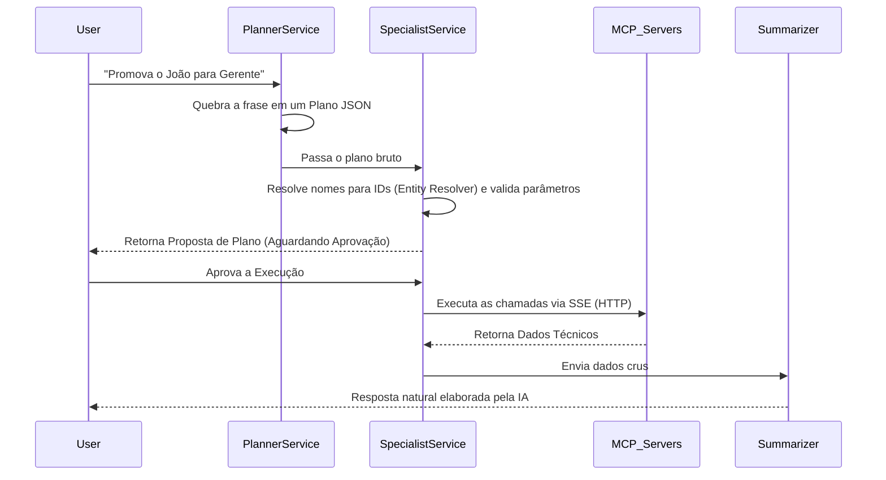

# Artemis API (IA Gateway / Orquestrador)

A `artemis-api` é o serviço central e o verdadeiro cérebro do ecossistema Artemis. Desenvolvida em **Java 25** e **Spring Boot 4**, ela utiliza todo o poder do **Spring AI 2.0** para orquestrar chamadas a modelos de inteligência artificial, roteando requisições entre modelos locais (**Ollama**) e na nuvem (**DeepSeek/OpenAI**). 

Atuando como um **Cliente MCP (Model Context Protocol)**, a API descobre dinamicamente as ferramentas e capacidades expostas pelos microsserviços (Servidores MCP) de forma automatizada, garantindo baixo acoplamento.

---

## 🚀 Fluxos de IA e Arquitetura

O orquestrador suporta **duas abordagens arquiteturais** para processar as intenções dos usuários, selecionáveis diretamente na interface:

### 1. Fluxo Autônomo (ReAct)
Nesta abordagem, gerenciada pelo `ReActAgentService`, o LLM opera com autonomia máxima.
- A ferramenta *Spring AI Tool/Function Calling* injeta todas as funções mapeadas dos Servidores MCP no prompt de sistema.
- O LLM aplica o modelo *Reasoning and Acting (ReAct)*: ele mesmo pensa, decide qual ferramenta chamar, avalia a resposta técnica e chama outras ferramentas iterativamente até atingir o objetivo, sem aprovações intermediárias.

### 2. Fluxo Estruturado (Plan-and-Execute com Human-in-the-Loop)
Abordagem altamente controlada e transparente, ideal para ações críticas:



---

## 🛠 Tecnologias e Requisitos

*   **Java 25** e **Spring Boot 4.1**
*   **Spring AI 2.0** (Com suporte nativo a Function/Tool Calling)
*   **Model Context Protocol (MCP)**: Integração via *Server-Sent Events (SSE)*.
*   **Modelos de IA**:
    *   **Local**: Ollama (Ex: `llama3.2:3b`) - Ideal para privacidade e testes offline.
    *   **Cloud**: DeepSeek / OpenAI - Roteados dinamicamente via `LlmRouterService`.

---

## 📂 Estrutura do Projeto

Os principais pacotes estão localizados em `src/main/java/com/candela/artemisapi`:
*   `Application/Services/`: Orquestradores principais, incluindo `ReActAgentService` e `ChatService`.
*   `orchestrator/service/`: Serviços do fluxo Plan-and-Execute (`Planner`, `Resolver`, `Specialist`, `Execution`, `Summarizer`).
*   `Presention/Controllers/`: Controladores REST consumidos pelo front-end.
*   `mcp/`: Gerenciamento e descoberta de clientes MCP.
*   `conversation/`: Controle de memória e contexto por sessão.
*   `config/`: Classes de configuração, como o registro de Tools (`ReActTools`) e Router (`LlmRouterService`).

---

## ▶️ Como Executar

### Pré-requisitos
1. **Ollama** rodando localmente (com um modelo baixado, ex: `ollama run llama3.2:3b`).
2. Variável de ambiente `DEEPSEEK_API_KEY` configurada se for utilizar os fluxos em nuvem.

### Rodando a API Isolada
```bash
# Navegue até a pasta da API:
cd artemis-api

# Compile e execute com o Maven Wrapper:
./mvnw spring-boot:run
```

> **Aviso de Ecossistema:** A `artemis-api` precisa se conectar aos Servidores MCP para executar ferramentas. Para testar a aplicação em sua totalidade (incluindo Front-end, Bancos de Dados e APIs de Domínio), utilize o script `start-all.sh` ou o `docker-compose.yml` localizados na raiz do repositório principal.
